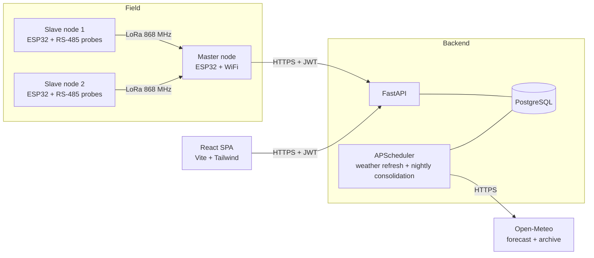

# Viñalert

**Precision viticulture platform for Spanish vineyards.** Viñalert collects soil
measurements from a network of solar-powered LoRa sensor nodes, enriches them with
hourly and daily weather data, and turns the combination into irrigation decisions,
treatment records and agronomic analysis.

The project is a full vertical slice: firmware on the sensor nodes, a FastAPI backend
with a PostgreSQL time series, and a React web application used in the field.

---

## Table of contents

- [Overview](#overview)
- [Architecture](#architecture)
- [Repository layout](#repository-layout)
- [Getting started](#getting-started)
  - [Prerequisites](#prerequisites)
  - [Backend](#backend)
  - [Frontend](#frontend)
  - [Firmware](#firmware)
- [Configuration](#configuration)
- [Database migrations](#database-migrations)
- [API reference](#api-reference)
- [Access model](#access-model)
- [Scheduled jobs](#scheduled-jobs)
- [Testing](#testing)
- [License](#license)

---

## Overview

A vineyard plot is instrumented with RS-485 soil probes wired to ESP32 slave nodes.
The nodes report over LoRa to a single master, which uploads readings to the backend
over WiFi. The backend timestamps each reading, captures the atmospheric conditions at
that exact moment, and consolidates everything into daily aggregates used by the web
application.

What the platform does:

| Capability | Description |
| --- | --- |
| **Soil telemetry** | Moisture, temperature and conductivity per sensor, with per-plot aggregation and configurable critical thresholds. |
| **Weather integration** | Hourly current conditions and daily aggregates from Open-Meteo, including historical backfill for retroactive analysis. |
| **Water balance** | Evapotranspiration-based irrigation guidance derived from plot geometry, crop coefficient, emitter flow rate and irrigation efficiency. |
| **Treatment log** | Phytosanitary treatment records, each reconstructed with the atmospheric conditions at the time of application. |
| **Foliar measurements** | Excel ingestion from Dualex handheld sensors (chlorophyll, flavonols, anthocyanins, NBI). |
| **Analysis** | Time series charts over configurable ranges, overlaying soil, weather, treatments and foliar readings. |
| **Multi-tenant access** | Multiple plots, multiple users, three permission levels per plot. |
| **Excel export** | Multi-sheet workbooks with detailed telemetry and simultaneous weather conditions. |
| **Device management** | Long-lived IoT tokens issued and revoked from the web UI; sampling interval configured remotely without reflashing. |

## Architecture



**Data flow.** Slave nodes wake on a beacon from the master, read their Modbus probes
and reply over LoRa. The master batches the readings, buffers them to flash if the
network is unavailable, and POSTs one request per sensor to `/logs/sensor/`. On
receipt the backend snapshots the current weather for that plot, so every soil reading
carries the atmospheric context it was taken under. A nightly job rebuilds the last
seven days of daily aggregates, which absorbs both server downtime and late-arriving
readings.

**Power.** The sampling interval is not compiled into the firmware. The master queries
`/dispositivos/configuracion` each cycle and stores the answer in RTC memory, so the
duty cycle can be tuned from the web UI without reflashing any node.

## Repository layout

```
.
├── app/                      FastAPI backend
│   ├── routers/              HTTP endpoints grouped by resource
│   ├── services/             Weather providers, consolidation, statistics, parsers
│   ├── models.py             SQLAlchemy ORM models
│   ├── schemas.py            Pydantic request/response schemas
│   ├── auth.py               Password hashing and JWT issuance
│   └── deps.py               Authentication and per-plot authorization
├── tests/                    Backend test suite (pytest, 305 tests)
├── vinalert-front/           React single-page application
│   └── src/
│       ├── pantallas/        Screens (status, sensors, analysis, treatments, …)
│       ├── componentes/      Shared components (sensor map, export modal)
│       ├── api/              Typed API client per resource
│       └── ui/               Design system primitives
├── vinalert_esp/vinalert_v2/ ESP32 firmware (Arduino)
│   ├── vinalert_maestro/     Master node: LoRa polling, WiFi upload, flash buffer
│   └── vinalert_esclavo/     Slave node: Modbus probes, LoRa replies, deep sleep
├── docs/
│   ├── specs/ · plans/       Design specifications and implementation plans
│   └── marca/                Brand assets
├── migracion_*.sql           Ordered schema migrations
├── semilla_inicial.py        Seed script for a fresh database
├── backfill_2026.py          Historical weather backfill
└── worker.py                 Standalone scheduler entry point
```

## Getting started

### Prerequisites

- Python 3.11 or newer
- PostgreSQL 14 or newer
- Node.js 20 or newer
- Arduino IDE or `arduino-cli` (firmware only)

### Backend

```bash
python -m venv .venv
source .venv/bin/activate          # Windows: .venv\Scripts\activate
pip install -r requirements-dev.txt

cp .env.example .env               # then edit .env, see Configuration below
createdb vinalert

uvicorn app.main:app --reload
```

The API is served at `http://localhost:8000`. Interactive documentation is generated
automatically at `http://localhost:8000/docs`.

Tables are created on startup from the ORM models. On a fresh database, apply the
migrations in [Database migrations](#database-migrations) and optionally seed it:

```bash
python semilla_inicial.py
```

The background scheduler starts with the application. To run it as a separate process
instead — recommended when the API runs behind multiple workers, so jobs are not
executed once per worker — use:

```bash
python worker.py
```

### Frontend

```bash
cd vinalert-front
npm install
cp .env.example .env               # set VITE_API_BASE to your backend URL

npm run dev                        # development server on http://localhost:5173
npm run build                      # production bundle in dist/
```

Make sure the frontend origin is listed in the backend's `CORS_ORIGINS`.

### Firmware

Boards are TTGO LoRa32 V2.1 (ESP32 with an on-board SX127x radio and SSD1306 display).

1. Copy the credentials template and fill it in:

   ```bash
   cd vinalert_esp/vinalert_v2/vinalert_maestro
   cp secrets.example.h secrets.h
   ```

   `secrets.h` is git-ignored. It holds the WiFi credentials, the backend base URL and
   the device token, which you generate from **Configuration → ESP32 devices** in the
   web application.

2. Set `SLAVE_ID` in `vinalert_esclavo/config.h` — it must be unique per node and match
   an entry in the master's `SLAVE_IDS`.

3. Verify the radio settings match on both sides: `LORA_BAND` (868 MHz in the EU),
   `LORA_SYNC_WORD` and `LORA_TX_POWER_DBM`. Check the band and transmit power against
   your local regulations.

4. Flash the master and each slave.

Slave nodes ship with `SIMULATE_SENSORS 1`, which generates synthetic readings so the
full LoRa → master → backend pipeline can be validated before any probe is wired. Set
it to `0` once the RS-485 sensors are connected.

See [`vinalert_esp/vinalert_v2/README.md`](vinalert_esp/vinalert_v2/README.md) for the
wiring diagram, the LoRa protocol and the commissioning checklist.

## Configuration

Backend variables, read from `.env`:

| Variable | Required | Default | Description |
| --- | --- | --- | --- |
| `DATABASE_URL` | Yes | — | PostgreSQL connection string. |
| `SECRET_KEY` | Yes | — | JWT signing key. Generate with `openssl rand -hex 32`. |
| `CORS_ORIGINS` | No | `http://localhost:5173` | Comma-separated list of allowed origins. |
| `CLIMA_INTERVALO_HORAS` | No | `3` | Hours between weather refreshes. |
| `WEATHER_PROVIDER` | No | `open-meteo` | Weather provider key. |

Frontend variables, read from `vinalert-front/.env`:

| Variable | Required | Default | Description |
| --- | --- | --- | --- |
| `VITE_API_BASE` | Yes | — | Base URL of the backend API. |

> **Never commit `.env` or `secrets.h`.** Both are git-ignored. If a device token is
> exposed, revoke it from **Configuration → ESP32 devices** and issue a new one.

**Adding a weather provider.** Subclass `WeatherProvider` in
[`app/services/weather.py`](app/services/weather.py), implement `fetch()`,
`fetch_diario()`, `fetch_archivo()` and `ping()`, register the class in `_REGISTRY`,
and point `WEATHER_PROVIDER` at it. The dictionaries returned must map exactly onto the
`LogClima` and `ClimaDiario` fields; each method's docstring documents the contract.

## Database migrations

Migrations are plain SQL files applied in filename order. They are cumulative — on an
existing database, apply only those added after your last deployment:

```bash
psql "$DATABASE_URL" -f migracion_2026_08_17_historico.sql
psql "$DATABASE_URL" -f migracion_2026_08_17_limpieza.sql
psql "$DATABASE_URL" -f migracion_2026_08_17_log_sensores.sql
psql "$DATABASE_URL" -f migracion_2026_08_18_cimientos.sql
psql "$DATABASE_URL" -f migracion_2026_08_19_multiusuario.sql
psql "$DATABASE_URL" -f migracion_2026_08_19_sensores.sql
psql "$DATABASE_URL" -f migracion_2026_08_22_intervalo_dispositivo.sql
```

Back up the database before applying migrations to a production instance.

## API reference

All endpoints except `/register` and `/token` require a bearer token:
`Authorization: Bearer <token>`.

### Authentication

| Method | Path | Description |
| --- | --- | --- |
| `POST` | `/register` | Register a user. |
| `POST` | `/token` | Exchange credentials for a JWT. |
| `GET` | `/me` | Current user and their plot memberships. |

### Plots

| Method | Path | Description |
| --- | --- | --- |
| `GET` `POST` | `/parcelas/` | List or create plots. |
| `GET` `PATCH` `DELETE` | `/parcelas/{id}` | Read, update or delete a plot (cascading). |
| `GET` | `/parcelas/{id}/dashboard` | Consolidated soil, weather and water balance summary. |
| `GET` | `/parcelas/{id}/historico` | Raw sensor readings over a time range. |
| `GET` | `/parcelas/{id}/clima/diario` | Daily weather aggregates. |
| `GET` | `/parcelas/{id}/suelo/diario` | Daily soil aggregates. |

### Sensors

| Method | Path | Description |
| --- | --- | --- |
| `GET` `POST` | `/sensores/` | List or create sensors. |
| `POST` | `/sensores/provisionar` | Bulk-provision a node's sensors. |
| `PATCH` `DELETE` | `/sensores/{id}` | Update or delete a sensor. |
| `GET` | `/sensores/resumen` | Per-sensor status summary. |
| `GET` | `/sensores/{id}/historico` | Historical readings for one sensor. |
| `GET` | `/sensores/exportar` | Export readings as a spreadsheet. |

### Ingestion

| Method | Path | Description |
| --- | --- | --- |
| `POST` | `/logs/sensor/` | Submit a soil reading. Used by the ESP32 master. |
| `POST` | `/logs/clima/` | Submit a weather reading. |

### IoT devices

| Method | Path | Description |
| --- | --- | --- |
| `GET` `POST` | `/parcelas/{id}/dispositivos` | List devices or issue a device token. |
| `GET` | `/dispositivos/configuracion` | Sampling interval. Polled by the master each cycle. |
| `PATCH` | `/parcelas/{id}/dispositivos/{did}` | Update a device. |
| `PATCH` | `/parcelas/{id}/dispositivos/{did}/revocar` | Revoke a device token. |
| `DELETE` | `/parcelas/{id}/dispositivos/{did}` | Delete a device. |

### Agronomy

| Method | Path | Description |
| --- | --- | --- |
| `POST` | `/foliar/upload` | Ingest a Dualex foliar measurement spreadsheet. |
| `GET` | `/foliar/` | List foliar readings. |
| `POST` `GET` `DELETE` | `/tratamientos/` | Manage phytosanitary treatment records. |
| `GET` `POST` `PATCH` `DELETE` | `/parcelas/{id}/miembros` | Manage plot membership. |

## Access model

Authorization is evaluated per plot, not globally. A user's role in one plot says
nothing about their access to another.

| Role | Permissions |
| --- | --- |
| `lectura` | Read-only access to data and analysis. |
| `gestor` | Everything above, plus recording treatments, uploading foliar data and configuring sensors. |
| `admin` | Everything above, plus plot settings, membership and device management. |

A superadmin, identified by a configured email address, can create plots and register
new users. Device tokens are a separate principal type (`dispositivo_iot`), scoped to a
single plot and device, and can only reach the ingestion and configuration endpoints.

## Scheduled jobs

Both jobs run under APScheduler with `misfire_grace_time` and `coalesce` enabled, so a
suspended or restarted host recovers missed runs instead of silently skipping them.

| Job | Schedule | Purpose |
| --- | --- | --- |
| `refrescar_clima` | Every `CLIMA_INTERVALO_HORAS` (default 3), plus once at startup | Fetch current weather for every plot. |
| `consolidar_diario` | Daily at 02:00 `Europe/Madrid` | Rebuild the last 7 days of daily soil and weather aggregates. |

## Testing

```bash
# Backend — 305 tests, SQLite in-memory, no external services required
pytest

# Frontend — 86 tests, mocked API responses
cd vinalert-front && npm test
```

The backend suite covers the permission matrix, the weather provider contract, daily
consolidation, the foliar parser, scheduler registration and every endpoint. Backend
tests run against an isolated in-memory SQLite database with a fresh schema per test;
no PostgreSQL instance or network access is needed.

## License

Distributed under the **GNU Affero General Public License v3.0**. See [LICENSE](LICENSE).

The AGPL requires that anyone who runs a modified version of this software as a network
service makes the corresponding source code available to its users.
